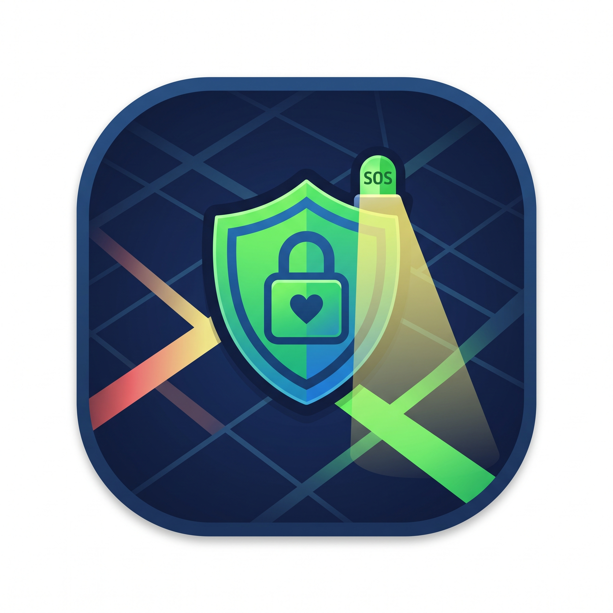

# ENTRECALLES

Aplicaciòn prototipo para asignatura de Emprendedores.

###Colaboradores
  -  Yoltzin Hernandez Canseco
  -  Juan Carlos Bastida Villafuerte

## Problematica
Al resolver las preguntas propuestas de "Problemas a Resolver", la que más destaco fue la problematica de seguridad. Principalmente hablando para los trayectos a pie, que por las noches, o en zonas poco concuridas pueden ser causa de problemas de inseguridad, ya sea por poca o nula iluminación o desconocimiento del lugar y las condiciones en las que se encuentra.

[Fotografia de Ralph Darabos en Unplash]

## Solución
Sería muy dificil en un primer momento cambiar las caracteristicas de todas las calles, reparar todos los alumbrados y conceder seguridad a los tranceuntes, pero consideramos que una manera bastante satisfactoria para apoyar en la solución de este problema es la creaciòn de una aplicación para celular que permita darle a conocer al usuario, entre otras cosas, las condiciones de los trayectos a los lugares deseados, consdierando su seguridad antes que todo.

Podriamos resumir en caracteristicas a la app en los siguientes puntos:

  -  Mostrar en un mapa OMS (OpenMapStret) las calles y trayectos más seguros y mas inseguros mediante un semaforo de peligro según las colonias o zonas.
  -  Mostrar las zonas de mayor concurrencia en el momento y en horas nocturnas mediante datos de la Web y recabados por la propia aplicación
  -  Mostrar los trayectos que por la noche cuentan con alumbrado público.
  -  Mostrar zonas de seguridad, hospitales y centros comunes, con sus números de contacto en primer plano.
  -  Incorporar un modo de "Peligro" de llamado automatico con ubicacion y sms a contactos de seguridad, mediante un codigo, palabra o combinación de botones.
  -  Mantener tres tipos de cuenta principal: Individuo (Persona Común), Individuo de Apoyo (Persona colaboradora, que en caso de emergencia podria apoyar al individuo en peligro, por lo que debe contar con ciertas aptitudes) y Autoridad (Instituciones y Autoridades)

Entre otras cosas.

-------------
Act. 19/10/2026
Como parte de la conceptualización de la aplicación, se le pidio a la IA Deepseek, mediante la información anterior que generara un prototipo en HTML, que ha sido montado en este repositorio y moderadamente modificado. Ademas, el icono provisional fue generado por IA.
